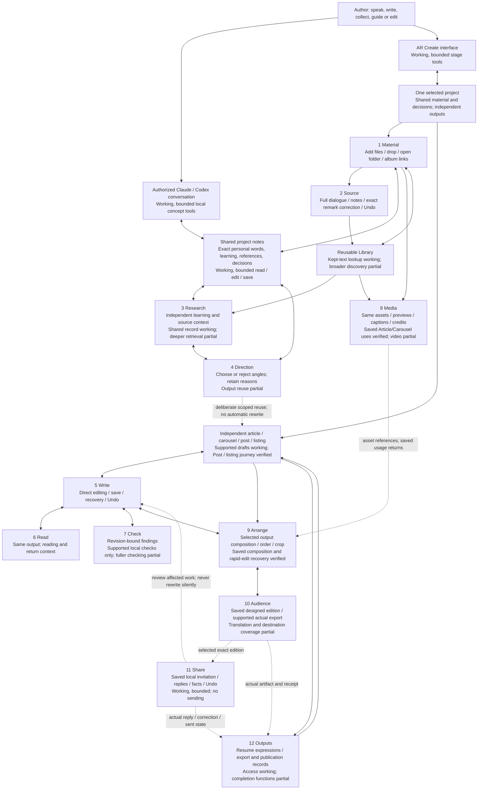
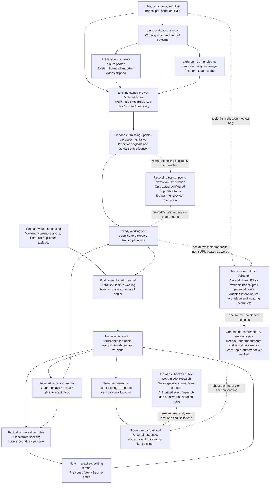
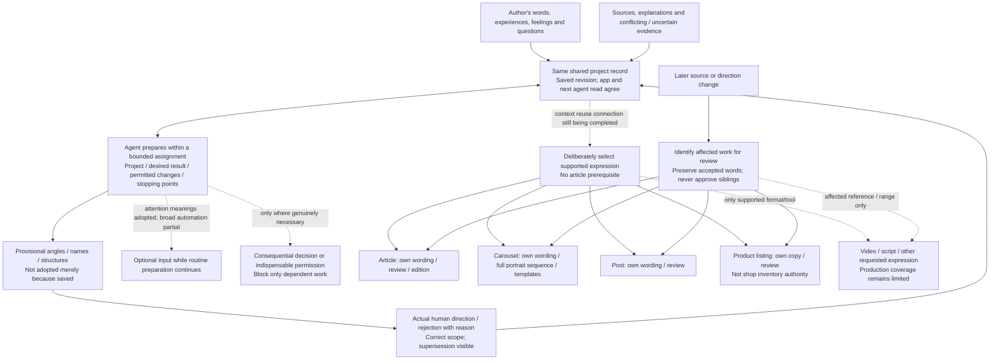
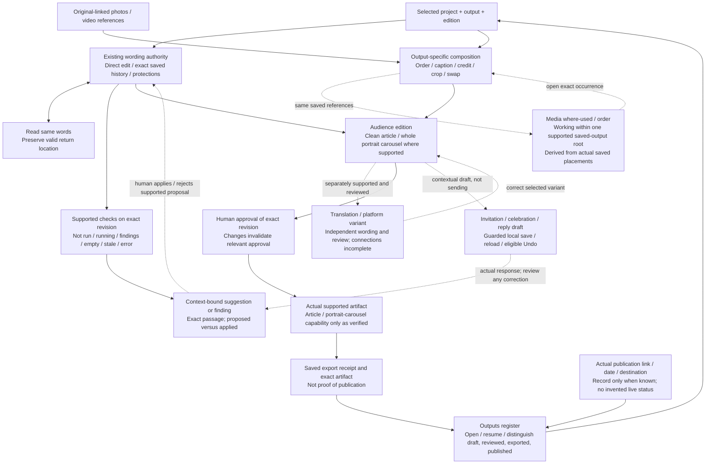
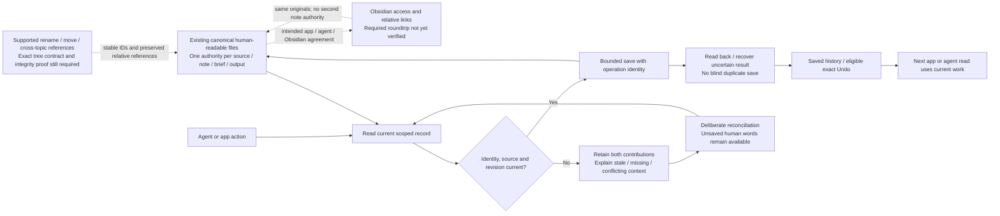
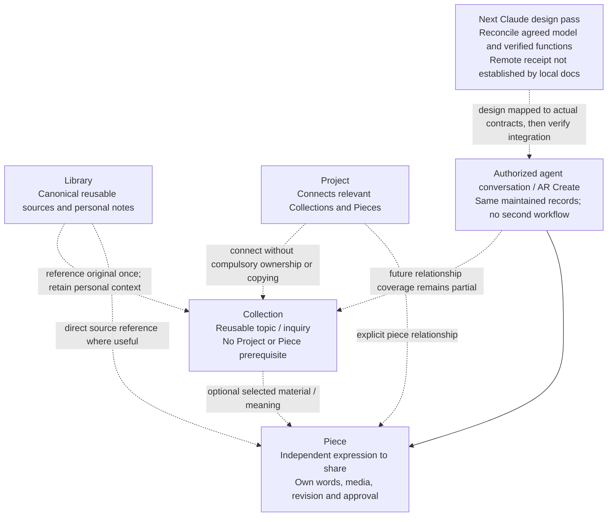
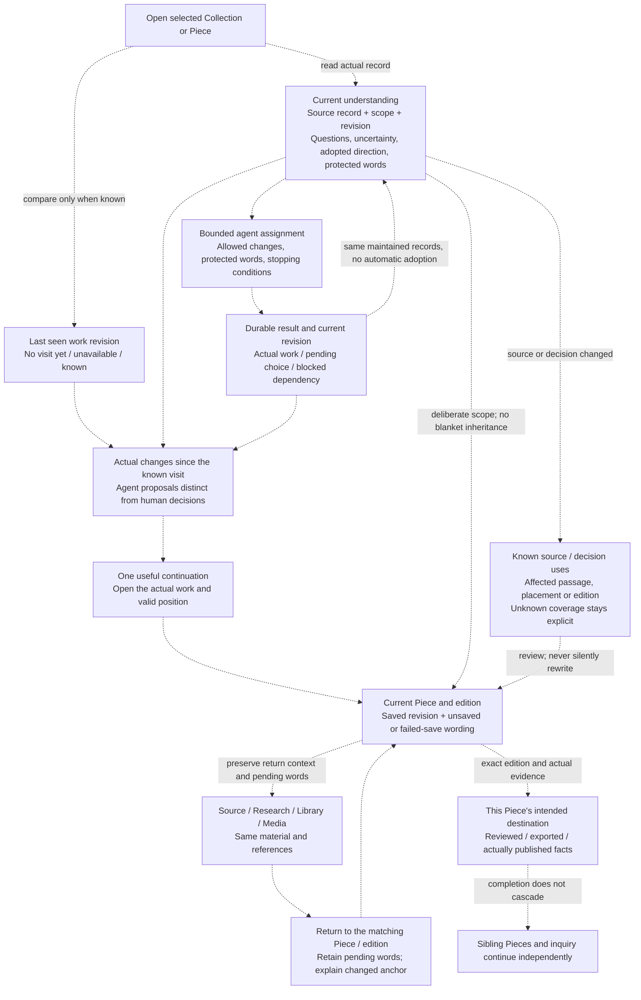

# AR Create — how the functions connect

Maintained 20 October 2026. Read this with the [function integration list](DESIGN-PASS-ADDITIONS.md), [product purpose](PRODUCT.md) and [twelve section briefs](sections/README.md). This is the connected view of those same requirements, not another backlog or a new application design. No private content or real project examples belong here.

**Status legend:** **Working, bounded** means the recorded installed behavior has scoped verification; it does not mean every requested operation works. **Partial** means some requested connections remain. **Not connected** means the action must not be presented as having run. Dashed arrows are intended or conditional connections, not proof of implementation. Provider access, editorial approval, exporting and publication are different facts.

## Current connection status — installed bounded checkpoint, 20 October

Standalone Collection learning, optional source-free Project connection, scoped current understanding/typed references/direction connections and work receipts are now installed alongside C3. Synthetic native proof covers pickup fallback, source/evidence acceptance and known/unknown impact, inherited direction/local override with sibling preservation, dirty context detours, bounded preparation/recovery and whole-Carousel completion facts. Exact installed bytes and read-only Learning library→same editor/words plus usable receipt controls are separately verified. These statements supersede older candidate-only notes below for those named edges, not all product functions.

Automatic one project-backed writing text at first typing, explicit earlier-browser-text reconciliation and expanded existing-receipt/session history are now installed as a separate bounded checkpoint. Synthetic native proof covers writes/conflicts/preview/new-operation restore/Undo; actual installed review is read-only and leaves existing earlier wording pending. Actual provider execution, private content-repository synchronization, device access, universal history and publication remain separate. See [the same integration list](DESIGN-PASS-ADDITIONS.md#installed-connected-c3-checkpoint--20-october).

## 1. Whole workspace

The author can enter through personal expression, material or a conversation with an authorized agent. All twelve checkpoints stay accessible. These arrows describe useful connections, not a compulsory linear wizard.

## 2. Collect, find and understand

**Important limits:** a saved URL is not imported media; a transcript is not its recording; translation or audio alignment is not inferred; an AI-generated note is not speech or human approval. A later correction makes affected notes/references need review; it does not erase the original. No match is scoped to the searched catalog, not the author's whole collection.

**Mixed-topic acceptance still to prove:** four invented video links with available transcripts and personal notes in one topic, a separate tea topic, source reuse between topics, safe save/switch/reload and agent read of later author amendments. A saved URL does not establish a retrieved transcript, AI synthesis or semantic indexing. Proposed compact-grid/batch/grouping mechanics are not approved screen design.

## 3. Author direction, agent work and independent expressions

Research has value without any selected output. Human experience is creative material, not automatically a factual claim or instruction. Agent preparation must not require approval of every routine action. Actual meaning/tone acceptance and publication authority remain human decisions. The interface must reveal meaningful work and allow intervention without requiring constant supervision; exact new attention layout is not yet approved or implemented.

## 4. Edit, arrange, review, export and return

Draft recovery/download is distinct from reviewed designed-output export. A draft artifact never silently clears review marks. Export errors, stale words or photos, unavailable originals and unsupported formats must fail truthfully and preserve recovery. Whole carousels remain available together; no compulsory slide-by-slide opening. Media selection is not placement; a crop changes its output occurrence, not its original or every other use. Full video editing, arbitrary platform publishing and remote synchronization are not established by these arrows.

## 5. Safeguards on every write

Project, source/session/remark, output/edition and placement scopes are not interchangeable. Original files, unknown/manual sections, chosen/rejected directions, exact words and independent outputs must survive every route. One maintained correction owner does not universally lock arbitrary external editors; detected outside changes still refuse stale mutation. Private content/configuration stays outside Git. Local service access is not remote/offline synchronization.

**Current location boundary:** the running app and its owned project work use the permanent local home. Accepted imported transcripts still rely on their existing external source authority and retained archive; that source home was deliberately not relocated during integration. The precise file-tree contract must map these locations before any supported move. Do not claim all sources have already moved outside earlier development locations.

**Shared-file contract remains unfinished:** inspect the existing private layout and agree its precise shallow extension before changing a tree. Prove a synthetic non-tea topic and tea topic with one reusable source, learning question/brief, personal note, selected passage and independent output references; test supported rename/move integrity and Obsidian/agent/app roundtrip. A filename does not prove interoperability. No live relocation, source duplication, new database or sharing of an entire private folder is implied.

## Latest bounded functional checkpoint

20 October: creating a Post or Product listing from a collection that already contains prose is repaired and installed. The synthetic native journey verifies creation, independent wording, save, switching, reload and exact saved Undo for both formats; the previous learning record, root wording, source and sibling output remain unchanged. Installed code matches the recorded repair pin. This does not establish automatic generation/context adoption, platform-specific short-format layouts, publication or completion of article/carousel/media/export work. Delivery retains the detailed receipt.

### Installed article and portrait-carousel checkpoint — 20 October

The bounded production journey now proves independent Article and Carousel wording, native photo upload/caption/credit, crop/seal/reorder, read-only designed Audience, actual HTML with embedded photos and eight 1080×1350 portrait PNG downloads. Exact saved article Undo and stale word/source/photo export refusal were exercised; sibling output, learning notes and sources remained unchanged. Root independently matched the three activated files against the recorded production receipt. Delivery retains exact candidate, native and artifact proof; no provider or publication ran.

That journey exposed lost **unsent** rapid visual edits across forced reload. The subsequent installed recovery checkpoint below supersedes that specific gap; recovery of an already dispatched request alone was insufficient. At this checkpoint, saved used-where/return navigation and Share/Collection/continuity integration were separate unfinished connections; later bounded updates below supersede only their named edges. The live result is not yet the final human-ready Claude handoff.

### Installed selected-output recovery checkpoint — 20 October

The full rapid visual-edit buffer now persists before dispatch, separately from the exact pending request. The synthetic native journey verifies forced reload without re-entry, offline/failed-save retry, source/native conflict hold, crop/photo/heading/credit recovery, two distinct browser copies and safe readable/downloadable recovery of closed-tab work. Earlier acknowledgments do not clear newer unsent values. Article wording/proof, sibling output, shared notes and source originals remained exact. Audience and Arrange now show only their own selected-mode highlight. Root independently matched all three activated file hashes against the permanent recovery receipt.

This proves bounded selected-output recovery, not every source/research/media detour or universal synchronization. Conflicting saved and browser words remain separate for deliberate recovery; no automatic merge or other-tab adoption occurs. Values lost before the repair cannot be reconstructed. At this checkpoint, broader standalone learning, relationship/current-understanding, Media used-where and Share connections remained unfinished; later updates below name the specific proved edges.

### Installed local Share and saved Media-use checkpoint — 20 October

Local Share now saves/resumes per-recipient/output/edition invitations, replies, translation text and explicit correction/fact references through guarded native ownership, with eligible saved Undo. The synthetic native journey verifies switching, reload, incoming outside-edit conflict, offline exact pending recovery and rapid unsent-tail retention. These are prepared/local records, not actual sending, translation-provider execution, publication or verified URLs.

Media now derives saved supported Article/Carousel occurrences from the maintained composition owners within one exact native root. Actual native clicks focus the correct Article occurrence or Carousel slide/photo, return to the same original asset, and reflect saved swaps and drag reorder on refetch. Eligible swap Undo restores exact slides; existing topology reorder is not eligible for Undo and was restored by native drag. Failed/offline photo details survive the composition detour. Root independently matched all thirteen activated files to the immutable Share/Media receipt; original wording, sibling output, notes/config and private content stayed preserved under the recorded activation checks.

Wider Library/all-root/video usage remains outside this measured coverage. Unsaved Share fields are tab-session recovery, while saved preparations persist on disk; this is not cross-device synchronization. Standalone learning, Project/relationship/current-understanding and continuity interface integration plus the final frozen-package combined journey remain required before the Claude handoff.

## 6. Library, Collections, Pieces and Projects — next-pass model

[Adopted conceptual direction](PRODUCT.md#adopted-relationships-before-folders--20-october) from Deep Review, 20 October. These relationships must be reconciled with the maintained identities below; they are not a completed store redesign, a namespace rename or migration authority.

| Product term | Existing contract to preserve | What is not yet proved |
| --- | --- | --- |
| Library | Existing source catalog, stable source identities, exact references, retained originals and owned personal-note files. | Complete mixed-format discovery, all proposed personal-relevance and cross-topic relationships. |
| Collection | Existing Library collection UUIDs, source membership and relates-to grouping are independent. Current shared-learning entrance can precede outputs but is project-keyed. | Standalone Collection learning scope in the same shared-record owner is not yet verified installed. Reuse the existing Library collection UUID; do not fabricate a Project/Piece, duplicate the learning body or introduce a new database. |
| Piece | Existing independently edited output and edition identities for supported Article/Carousel/Post/Product listing. | Every requested format, platform, export or automatic reuse capability. A script is not a rendered video. |
| Project | Current maintained project identity, associated material and independent outputs. | The full optional Project-to-multiple-Collections/Pieces relationship contract. Do not require a Project to begin independent learning simply because current storage uses a project identity. |

**Bounded Project mapping:** the existing named saved workspace can represent the human Project in this local pass; no separate entity or multi-workspace Project is required by the adopted model. Preserve exact maintained identities. Project-to-Piece membership resolves native parent/root bindings, not a guessed shared physical workspace. Accepted Collection-to-work usage references may establish association; proposal, organizational membership, source/edition freshness and permission to inherit direction remain distinct. A stale usage reference flags review without erasing organizational navigation. A source-free Collection remains independently useful; unavailable source-free attachment is an explicit gap, never a fabricated source. Deep Review adjudicated this mapping; actual two-Collection/Project/Article+Carousel drift/detach/Undo proof remains with Delivery and Build before completion.

The designer needs one explicit existing-to-intended mapping before choosing new labels or relationships. Keep the first Claude pass intact; carry this as a dated next-pass delta in the same integration list and versioned handoff. A local file or an authorized local Claude tool does not prove Claude Design in the cloud received the update. Returned designs must be reconciled against current verified functions and recovery/approval boundaries before integration.

## Coverage and maintenance

The authoritative status, owner and finish criteria remain in [the integration list's section map](DESIGN-PASS-ADDITIONS.md#section-and-connection-map-for-the-combined-handoff), with detailed proof on Delivery's existing checklist. All twelve sections appear above. Optional future Library, media, provider and private-access work remains visible with its actual limits rather than silently being omitted from the handoff.

For every functional delivery, the owner supplies its changed nodes/edges, affected section IDs and proof/limits. Delivery updates the same integration list; the flowchart maintainer updates this file from that accepted result. Update connections and status before freezing a Claude handoff. Do not make a feature appear complete merely by changing a label or arrow.

The design-ready handoff must contain the reviewed current code-only source/package, this map, the same function integration list, section purposes, recovery/approval invariants and synthetic concept-first/material-first scenarios. Latest human instruction prioritizes that packet now with honest unfinished-state labels; full functional completion is not its entry gate. The first Claude design remains intact until a separately reviewed integration. Builders test the combined installed experience; the author is invited for a usability/taste walkthrough only after the redesigned interface is integrated and verified.

## Adopted ease-of-use overlay — 20 October

Apply the [six adopted improvements](PRODUCT.md#20-october--resume-creative-work-without-reconstructing-its-history) across these same connections. Prioritize Pick up here and Current understanding; they are accepted requirements, not newly verified functions. The visible return path is selected Collection/Piece → current understanding and actual changes → one useful continuation → source/research/media detour → same work. The twelve checkpoints remain accessible beneath this journey. Scoped source/decision changes lead to known affected work or an explicit uncertainty; bounded agent work uses the same records; completion belongs to each Piece/edition while inquiry may continue.

Before the next Claude handoff, Deep Review checks this map's paths and Delivery reconciles accepted requirements, actual connection proof and unfinished edges with the sole Build owner. Preserve the active Claude build. Keep detailed implementation status in the existing integration list, not this acceptance overlay.

## 7. Return, understand and continue — adopted paths awaiting connection proof

This overlays the same existing records and twelve checkpoints. Dashed edges below require implementation or combined proof; they do not announce another store, completed automation or replacement interface.

**Deep Review reconciliation:** the six adopted paths have concrete unproved edges: per-work last-seen revision → truthful return digest; scoped/revisioned current-understanding record → deliberate Piece inheritance; dirty or failed-save draft → source/media detour → matching work/revision; source/decision → known reverse-use links with unknown coverage disclosed; bounded assignment → durable result/stopping receipt; Piece/edition → intended destination and actual completion facts. See the [same integration list](DESIGN-PASS-ADDITIONS.md#deep-review--concrete-path-gaps-20-october). Library grouping already exists independently; standalone learning scope remains the missing connection. Recommended order follows the current export/Share slice, then Collection scope/relationships, current understanding/safe detours and pickup/change review. Delivery sequences implementation; no completed edge is inferred from this review.

## Latest handoff priority — design and wiring in parallel

[20 October direct human instruction](PRODUCT.md#20-october--design-ready-handoff-comes-first): deliver the reviewed current code-only design packet now. These diagrams and the same integration list show where every agreed function belongs, what it does and what remains unfinished. Keep prepared/unmounted and intended edges visible and truthful; the next designer need not wait for their live wiring. Preserve the current Claude build. Continue the functional goal and builder-owned native verification separately; this packet is not proof of full completion.

### Earlier connected candidate proof — superseded by the installed status above

The isolated candidate now has actual synthetic proof for source-free learning shared between agent and app, explicit Project association, exact Article/Carousel scope, prepared assignment and changed-context review with both proposed and human wording retained. Offline preparation → reload → exact-command retry preserves newer typing. Per-edition completion checks all eight actual portrait PNGs plus caption and output JSON; an attributed manual destination remains separate, and eligible Undo restores the previous completion receipt exactly.

This is **candidate evidence, not installed behavior**. Combined dirty-writing Source/Research/Media detours, story/scope departure, narrow/dark verification and final source/activation proof remain open. No external research, AI execution, publication or universal synchronization is established. Delivery retains the permanent `continuity-native-checkpoint-20261020/FINAL-RECEIPT.json`; the delivered Claude Design snapshot `8334d28bf8c0` remains unchanged.

### One working text, History and visible Library installed — 20 October

First author typing resolves the maintained owned Piece file with local save-ahead and guarded file save; startup does not silently import a different earlier browser buffer. Read-only session/version preview and restore-as-new-operation use existing receipts/inverses, with exact saved Undo and explicit unavailable-history refusal. C3 History calls the actual owner panel, and the visible C3 Open/create Learning library action preserves native-part return independently of Project/output creation. The synthetic combined journey and separate exact installed/served/read-only preservation checkpoint pass. No real earlier-wording decision or private prose restore was performed; manual choices remain the author's.
