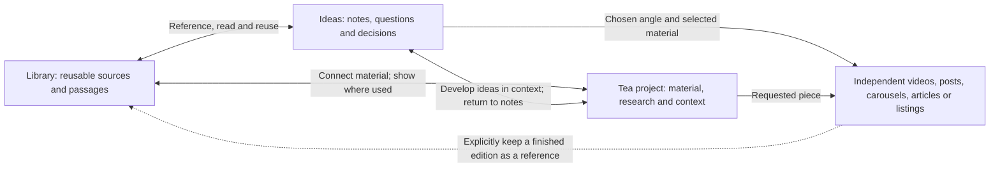

# Library, ideas and tea projects — next design pass

18 October 2026 · Proposed design sequence for Adrian's review.

**Boundary:** leave the active Claude Design pass, its attachments and its next returned version unchanged. This plan is for a subsequent pass. It does not start implementation, modify the installed application, replace an editor or source store, import private material, enable providers, or authorize publication. Accepted product intent lives in PRODUCT.md; this document proposes how to design it together. Requirements and proposed screens are not completion proof.

Feature changes accumulated during the frozen first pass are tracked in [the design-pass additions record](../../DESIGN-PASS-ADDITIONS.md). Read its working, limited and proposed states before the subsequent design round.

## One connected workspace

The recommended approach is **agree the connections first, develop three focused experiences, then review one integrated journey**. Do not design three independent applications and leave their relationships until the end.

| Area | What it is for | What it owns | What it connects to |
| --- | --- | --- | --- |
| Library | Find, read, organize and reuse the resources deliberately kept | Original-linked resources, related versions/translations, passage references, annotations, personal relevance and known reading coverage | Many projects, ideas, research inquiries and outputs |
| Idea development / concept brainstormer | Explore what the author wants to understand or say | Rough notes, questions, protected phrases, alternatives, selected references and explicit creative decisions | Library passages, existing projects, research and optional independently edited outputs |
| Tea project | Develop ongoing work around a tea and the author's encounter with it | Project context, selected resources, research, ideas and requested pieces | Shared Library resources, other relevant projects and Teajia's supplied product reference |

A tea project is a normal flexible project, not a separate product database or mandatory project type. Idea development is a working surface within the same project model, not another application or manuscript authority. An idea can stand alone without a tea or output; a tea project can contain several ideas; an idea can draw on several teas and conversations. Turning an idea into work does not require an irreversible Convert action or a fresh intake process.

Projects and Library need clearly distinct entrances. The compact current/pinned/recent project rail remains a return point; the full resource Library and All projects serve different jobs. Precise navigation labels remain a design choice. An internal source service named collections does not mean topic collections and projects must become the same user-facing object.

The arrows are links and deliberate handoffs, not automatic copying, approval, generation or synchronization. Adding notes or research to a project may deliberately create a new resource. Merely linking a source does not create another original. Keep a completed edition as a Library reference only through an explicit action; a new draft is not automatically indexed as authoritative evidence for itself.

## Personal expression and either starting point — one existing tool

This is an integrated part of AR Create. Library discovery, concept development, research and output creation must not become new islands. The author can enter through either route and continue in both directions:

- **Concept first:** start a thought or question; express personal feelings, memories, observations and what they hope to convey; then ask for relevant or challenging Library material and research when useful.
- **Material first:** find a conversation, passage, image or clip; begin or connect an idea; add the author's personal response, questions and direction.

Neither route is the default prerequisite. Both can stay exploratory with no deliverable. Saving a concept must not depend on retrieval, having a transcript or creating an article. The example and next design review must demonstrate both routes rather than imply Library → concept is the required order.

At the concept entry, provide a prominent continuous editable place for **the author's own contribution**. A proposed plain label is Your thoughts; it is not an approved final label or a compulsory extra form. The author can type, speak through existing supported/permitted tools, or attach a personal note/image/clip. They should be able to express what happened, how it felt, what it means to them and what they want to communicate. Library links and AI discussion assist this work without displacing it. Notes can grow and change throughout the project, rather than becoming a one-time setup answer.

Personal contributions have two compatible uses: original material for content and direction for how AI helps. Do not reduce them to prompts, untraceable chat context, outside evidence or automatically polished AI prose. Keep the author's exact original version alongside any proposed structure/interpretation. Respect explicit background-only or intended-for-use choices without adding a classification chore to every sentence. Carry relevant intent into tone, emphasis, selected visuals, narration and sequence as well as writing. Show what the author chose and which pieces it guides; keep later changes reversible and scoped.

### Same-page AI discussion, quick lookup and full Library

Human preference now selects **Library on demand plus its own full surface**. This is not approval of every detail of the initial concept preview. The next proposal can offer an optional AI conversation beside the author's thoughts, with a clear Talk with AI entry on narrow screens; work does not have to happen there. It supports developing the point, exploring feelings/questions and asking for relevant Library material. Personal statements in that discussion remain attributable contributions in the same project; they are not only commands. An optional Keep this thought action helps organize exact wording in the visible notes, without making it a requirement for relevant conversation context to carry forward.

Use the current concept's permitted thoughts, creative direction, relevant discussion and chosen source context. Make the context inspectable and keep AI replies/proposals distinct from human words. A suggested connection shows why it could help, the source's identity and readable passage/context. Connect only selected material; no silent note rewrite, whole-library prompt, claim approval or original-file copy.

Quick Library is an on-demand lookup in the assistance area; return to the same discussion without losing a message being composed. The full Library is its own resource-browsing/organization surface inside AR Create, reached through app navigation, with a clear return to the concept. It uses the same resources and selected relationships, not a second store or forced project-specific catalog. It remains useful without creating content. Linking a resource back must retain notes, human choices and conversation; no mandatory reimport or project conversion.

The updated in-conversation proposal demonstrates those transitions with invented resources and explicit sample replies. It does not connect a model, search the private Library, or establish real saving/voice/media/export. The actual conversation, retrieval and revision contracts must be wired through existing owners after relevant review. Claude's current build, attachments and next returned result stay unchanged.

### Equal entrances: AI interface and visual workspace

Latest direct human clarification: the conversation and organizing can happen in an authorized agent interface, often while AR Create is not being used. The visual workspace and agent tools are reflections of the same work, not separate workflows. Keep the app useful for seeing, editing and directing what agents did; keep supported agent access useful without an app session or compulsory in-app chat. The same project, personal thoughts, selected Library references, creative decisions and independent outputs carry across either entrance.

Reuse maintained file/tool connections and identities/revisions rather than inventing another store or assuming arbitrary chat history automatically synchronizes. Record relevant exact human contributions and adopted decisions in the shared work with their proper scope; unrelated/private background discussion is not automatically imported or published. A UI edit is available on the next authorized agent read; an agent change appears when the app opens/refreshes and, when connected, during use. Disclose actual freshness and connection limits. Preserve unsaved work on concurrent changes and require conflict resolution rather than last-write-wins replacement. Rejected proposals stay rejected; new instructions visibly supersede earlier ones, and pending assistance uses current context.

Bounded later proof: (1) app closed, a supported agent path adds a personal thought/decision and links a Library passage; (2) open the matching concept and see those same exact records without import; (3) change direction/text in the app and verify the agent reads the new revision; (4) introduce an incoming change against an unsaved edit and preserve both; (5) confirm independent output wording/approval is not silently changed. Do not claim any of this from synthetic preview behavior. C01/C03/C04/C06 govern acceptance; this is not new provider, private transmission, cross-device sync or backend architecture authorization. Preserve Claude's active build and next returned design.

### Integration points in the current application

| Existing part | Extension for this work | What remains shared and preserved |
| --- | --- | --- |
| Project creation and resume | Start from an idea or existing material and return to the same evolving work | Existing project/part identity, short rail, All projects and saved position; no mandatory new project type or conversion |
| Material | Add personal notes/media and find/link existing Library resources around the concept | Existing source identities, intake for new material, folder relationships and processing tools; no second source store |
| Research | Explore questions arising from the author's thinking or sources and return useful understanding to the same work | Existing Magazine/Atlas inquiry, evidence distinctions and human decisions; no compulsory output or duplicate research process |
| Direction | Hone what the author wants to express, compare angles and decide which requested pieces to make | Same concept context, original personal contributions, alternatives/rejections and existing scoped direction records; no new thirteenth stage |
| Existing editors, media work and Outputs | Use selected concept context to develop each requested expression | Existing manuscript authority, media tools/templates, independent content/revision/review, exact saved Undo and actual export contracts |

These are interaction/ownership connections, not an approved storage schema. Reuse maintained file/context/decision mechanisms; if a new persisted field becomes necessary, the integrator must identify the bounded gap before implementation rather than create a parallel engine or bulk migration. A global Library view and a concept surface remain places inside this tool, not separate products, required permanent chats or competing workflows.

The next design pass must reconcile these extensions with the design currently being built and the working code, preserving the chosen editor, navigation and live handlers. No current Claude attachments, brief or next result are changed. Do not build a standalone prototype application as the implementation of this concept workflow.

## Concepts are for content, not only writing

The author explicitly clarifies that ideas can become videos, social/visual posts, carousels and other content as well as articles. An idea may start with footage, an image, a voice thought or references rather than typed prose. A script is one possible supporting artifact; it is not the finished video and is not a compulsory entrance. Keep the shared concept independent of its eventual format. Use the current document tools for writing and notes, with appropriate media preview/selection/sequence surfaces when relevant rather than rendering every activity as a text page.

The later design should demonstrate a single concept supporting a short video and a post as well as optional long-form work. Show selected clips/images, intended sequence, narration/captions and format-specific framing where requested; connect to maintained media work instead of inventing a new engine. Each output keeps its own content, layout/sequence, revisions and human review. Represented video tools and proposed output routes do not mean video assembly, rendering, AI trimming or platform publication are connected. This clarification leaves the current Claude pass unchanged.

## Shared behavior to agree before separate design

1. **Reference the same resource.** Opening a transcript from a project or an idea returns to the same recording/transcript/version chain. Topic collections and project membership do not silently move physical originals. Show original location and availability under useful secondary details.
2. **Distinguish scopes.** A source annotation describes the resource; a project note describes this work; a direction can apply to one output. When broader scope is ambiguous, keep the contribution local and make scope visible. Do not promote one piece's decision into a universal belief.
3. **Keep the author's meaning.** Personal experience, exact words, corrections, chosen directions, rejections, direct edits and later changes of mind retain attribution, scope and revision. AI suggestions stay separate until accepted. Research can challenge an idea without silently deciding what the author believes.
4. **Pass selected context, not the entire library.** Search suggestions show the matching excerpt, its origin and why it fits, with full context reachable. Explicitly chosen notes/passages and relevant decisions carry into research, directions and drafting. No blanket private-library upload follows from search intent.
5. **Use material without repeated intake.** A deliberately kept resource can be linked directly. Unknown incoming recordings/files use existing intake review and processing; receiving audio is not successful transcription. A project may start with notes and acquire recordings later.
6. **Changes invite targeted review.** A corrected transcript, revised note or superseded direction identifies relevant downstream work and preserves the version used. Do not overwrite current words, silently approve claims, re-run AI or invalidate unrelated sibling outputs. If exact impact is unknown, state that review may be needed.
7. **Keep movement and removal unambiguous.** Remove from this project, remove from a topic collection, archive and delete an original have different consequences. Default organization is reversible. This design task authorizes no deletion operation or original-file moves.
8. **Preserve continuity.** Library detours, opening an idea and switching projects return to the right document/part/output and position. Save failures protect the current words. Keep exact saved Undo, historical snapshots, source identity and independent output approvals.

## Worked example — one tea concept, three different pieces

This is an illustrative future-design scenario using invented material, not a claim that Adrian's real Library has been searched or that any quote, tasting observation, footage or tea fact has been found. Use synthetic counterparts in shared design files. Do not upload private sources to make the demo realistic.

### The concept and the author's contribution

Working concept: **What makes a tea meaningful beyond its label?** This is a proposed example title, not a statement attributed to Adrian. The author wants to explore an encounter with a tea: what drew their attention, what they personally experienced and what they still want to understand. No final title, selling claim, recording, article or chosen format is required to begin.

In the mixed-material idea surface the author has a prominent place for their own thoughts, feelings, memories and personal meaning. They can begin there before searching Library, type or dictate their point through supported tools, attach a photo/clip, ask questions and set a creative instruction. An illustrative instruction is to keep the work grounded in the personal encounter rather than make generic sales copy. Exact phrases the author chooses to protect remain exact; alternative interpretations, visual references and unanswered questions stay available.

### Find useful material in Library

| Example resource | Why it could help | What the author sees and chooses |
| --- | --- | --- |
| A conversation about discovering the tea | Reconstructs the encounter and what was actually said | Matching turns with speaker and real time position if available; play/read surrounding context, then link the chosen passage or full conversation |
| A second conversation about a related tea or practice | Adds a connection, distinction or challenge | Suggested relationship and relevant excerpt; the author decides whether this comparison belongs |
| Their own tasting note or prior writing | Preserves personal impressions and language | Original wording, date where known and relevant annotations; choose phrases or passages without AI presenting them as established facts |
| Product/leaf photographs and brewing footage | Supplies the visual story | Thumbnails/playable previews where supported, original location, known subject/capture details and usage links; choose the actual images/clips |
| A deliberately marked book/Atlas/reference passage | Adds background or raises a research question | Exact marked text, source/location and personal annotation; full context is reachable and unread portions are not presented as endorsed |
| Generated illustration, if one exists | May provide a clearly illustrative visual | Explicit generated-art label; never present it as evidence of the actual product or encounter |

Search can begin from a remembered conversation, topic or meaning; suggestions show why they match rather than silently collecting everything with the word tea. Keep factual support separate from personal relevance. Link selected resources into the concept/project without moving originals or duplicating files. Newly added, unreviewed material can still use existing intake and processing.

### Understand before making pieces

Research develops the actual questions raised by the selected sources. It may explain unfamiliar terms, compare what different speakers said, consult permitted Library/Atlas material and show what needs external evidence. Source-only reasoning is not external verification. A seller's assertion about age, origin or quality remains attributed or uncertain unless supported; the author's sensory experience stays personal. No generic tea facts, manufactured quotes or invented tasting language are needed to fill the example.

The reusable brief retains the author's intention, selected evidence/context, protected wording, open questions and rejection reasons. The author chooses the angle for each piece. Relevant shared decisions carry forward once; platform-specific choices remain local. Learning may continue without creating any output.

### Three expressions from the shared concept

| Requested piece | Purpose and illustrative structure | Work surface to show in the later pass | The author's decisions |
| --- | --- | --- | --- |
| Video | Let viewers experience the encounter. For example: discovery scene → relevant conversation excerpt → brewing/detail sequence → personal reflection. A short duration is a design example, not a fixed requirement. | Playable preview plus the whole proposed sequence, source-linked clips/stills, trim/in-out points where supported, narration/captions and format framing. Show where existing footage selection/trimming work connects. A script or storyboard is not a rendered video. | Choose the hook, actual shots and pacing; correct narration/subtitles; keep/reject suggested cuts; approve this video's actual sequence and content |
| Post | Share one strong observation or question from the encounter, with one chosen visual or a requested small set. It need not summarize the article. | Image/video preview beside directly editable caption and destination-specific presentation; sources and relevant creative choices remain available without leaving the piece | Choose the visual, personal wording, emphasis and invitation; review this post independently |
| Article | Develop the lived encounter with room for explanation and nuance. For example: personal opening → conversation/discovery → research in context → reflection and remaining questions. | Continuous manuscript, contextual margin discussion, linked research/quotes and appropriate photo placement using the existing editorial/recovery tools | Choose the structure and amount of background, polish exact wording, approve quotes and select images; article approval does not approve the post or video |

AI helps prepare alternative hooks, source suggestions, research explanations, sequences, captions or structures when the relevant operation is connected. The author directs meaning and final expression. No silent generation, auto-approval or public posting follows from choosing the three formats. The example requests all three to test reuse; ordinary projects need only the formats Adrian actually wants.

### What stays connected on screen

The tea project gives a compact route back to the concept, selected Library material, research and the three requested pieces. Do not impose a new top navigation structure or add compulsory workflow stages merely to show these connections. Each piece shows its own current work/next action, not a copied shared progress label. From a passage, image or clip, open the actual source context; from Library, see which concept/project/pieces use it. Show only truthful connections and known usage.

A change to the concept or a corrected source flags specifically affected work for review, with the version originally used retained. It never silently changes approved captions, narration, cuts or article words. Changing a crop/trim for one occurrence must not destructively alter the original or every other use. Video, post and article have separate content/media revisions and approvals; revisions and review must not be reduced to manuscript words alone. Uncertain impact is a stated review need rather than an invented precise dependency.

### Combined next-pass review

Show this as one coherent interactive design scenario after the current Claude pass returns:

1. Start the concept from the author's spoken/written thoughts and feelings, optionally a photo, with no Library resource or article required. Also demonstrate arriving from a Library item into this same personal work.
2. Find two candidate conversations, a personal note, chosen media and a marked reference passage; inspect context and select only the useful material.
3. Develop understanding and retain one protected phrase, a direction choice and a rejection reason.
4. Request Video, Post and Article; show three distinct work surfaces from shared material with relevant decisions already present.
5. Adjust a clip sequence, edit the post caption and polish an article passage. Switch projects and return without losing the intended location or work.
6. Correct an upstream source and inspect affected pieces without overwriting their edits or approving anything automatically.
7. Show each piece's real or explicitly illustrative preview/export state. Label any unconnected video rendering, AI, destination export or publication clearly; no fake download or Saved/Published success.

A design demonstration proves navigation and proposed interaction only. Later implementation must separately prove native saving/recovery/revision behavior and actual media/export operations on synthetic fixtures. Do not claim finished video production merely because its controls or preview mockup exist. This example adds to the subsequent design pass only; the active Claude build, attachments and next returned result remain unchanged.

## Design sequence

### A. Map the basic connections

Produce one low-detail navigation/relationship map, a concise vocabulary and a single invented tea example. Show where Library, Projects, ideas, Research and Outputs are reached; how to return; and what gets linked rather than copied. Use the current Claude result when available and the then-current working application as the foundations. This is a map for the next pass, not another full visual redesign.

**Review criterion:** Adrian can explain where to keep a conversation, where to think about it and where to develop a tea release without learning three workflows. Display the proposed empty states as well as the populated example.

### B. Develop Library on its own

Design for substantial growth: a complete Library entrance, clear filing/home locations, topic collections, search, resource/language filters and useful saved views. Keep result loading bounded. Show readable list/preview modes and media thumbnails where useful; a file tree alone cannot carry the experience. Do not force every resource into one exclusive topic or require a metadata questionnaire.

Show own writing, participated conversations/transcripts, saved reading/PDFs/ebooks, translations and video references. Translations remain linked to their originals. Find the resource through a remembered topic as well as available names and metadata; demonstrate planned meaning-based discovery honestly if not connected.

On a resource, read/play what is actually supported, inspect original/corrected/translated versions, mark an exact passage, add why it matters, and see where it is used. Provide clear actions such as Use in a project and Add to an idea. Existing project material should be reusable without another import.

Keep personal connection, factual credibility and reading coverage separate. Saving a book does not mean reading it; AI processing is not human endorsement. A personally marked book passage can be more relevant than a loosely related personal conversation. No opaque universal importance score or compulsory format ranking.

**Design checks:** synthetic mixed catalog large enough to prove bounded navigation (for example 1,000 resources), no matches, unavailable desktop original, unsupported reader, partial reading, original/translation pairs and one source used in multiple projects. No actual thousand-resource import or indexing work is authorized by this design example.

### C. Develop idea work on its own

Start with a thought, belief, question, photo/clip, spoken reflection or rough notes. Recommend a continuous mixed-material scratch surface with editable notes, movable sections, accessible media references and optional contextual AI discussion. The author can start with any of those, explore several angles and leave without producing content. Avoid mandatory title, recording, output or belief forms.

Demonstrate: write a personal point; recall two conversations and a related article; inspect suggested matching passages; select references; ask a question; examine contrary evidence; refine a phrase; compare possible titles/angles; record a rejection and its reason. Source wording, human notes and AI interpretation remain visibly distinct.

Keep a small understandable set of current creative decisions near the work; retain history behind it rather than making the document a wall of warnings. Choosing an angle for a short post must not narrow every other possible piece or rewrite the original scratch notes.

**Design checks:** no sources yet; several candidate conversations; ambiguous speaker; an unavailable reference; a changed source; pending/unconnected AI; a later change of mind. Return after a Library detour without losing place or words.

### D. Develop the tea-project experience on its own

Use the existing project and stage-specific surfaces. Show actual roles for recordings/transcripts, opening/closing notes, personal tasting/discovery, photographs/video, clearly labeled generated artwork, research questions and supplied product information. Keep Library additions and new material intake available in place.

Provide a concise project overview with a meaningful next action, accessible research/idea work and requested output links. Preserve the twelve underlying checkpoints; this plan does not add three new compulsory stages. A collection can remain learning/material only, or produce a post/listing before an article exists.

Show supported product facts, attributed seller claims, unresolved claims and the author's sensory experience distinctly. A Teajia product reference connects listing content to the existing shop record; AR Create does not own price, stock or orders. Each selected article, post, listing, carousel or script has its own words, selected material, review, version and actual delivery status. Do not populate unrequested formats as unfinished obligations.

**Design checks:** new tea with only photos and a rough note; a tea with several recording sessions; a project with no planned outputs; several pieces in different states; generated versus actual product imagery; adding new research after one piece has been completed.

### E. Integrate the complete experience

Combine the reviewed components with the returned Claude design in one isolated design candidate. Align navigation, hierarchy, typography, compact controls, status vocabulary and return behavior. Do not squeeze every surface into a single layout; each must serve its work. Present unfinished operations in their proper places with explicit illustrative/not-connected behavior; a prototype must not masquerade as a working save or AI result.

Use one coherent illustrative journey:

1. Show both entrances: begin with the author's concept and personal thoughts before any Library lookup; alternatively find a conversation and read the exact relevant turn.
2. Continue in the same concept/project; link a relevant conversation and marked book passage, preserving the author's personal expression as its own material.
3. Connect that idea to an existing tea project and add another recording or photo there.
4. Develop understanding through Research; carry the author's chosen point and protected phrase forward.
5. Develop a short video direction and social post from one concept; show chosen clips/images, framing, sequence/narration and independent review as appropriate. An article or listing is optional and not a prerequisite. Clearly label any video production/rendering operation that remains unconnected.
6. Edit one piece, visit another project, return to the right place and inspect where its sources came from.
7. Correct a shared source; show affected work needing review without changing accepted words.
8. Show actual export/publication status only where supported and known; no automatic shop/social release.

**Review criterion:** the author can move through this journey without repeated import, repeated explanations, scattered note boxes, lost context or extra ceremonial clicks. Check wide/narrow and Light/Dark, useful scrolling, multi-item selection where appropriate, keyboard return and the empty/processing/error/read-only/changed states that affect this journey. Human visual review is separate from functional proof.

### F. Wire reviewed slices through the existing owners

Only after the relevant design direction is reviewed, Delivery turns its gaps into bounded rows on the existing board. Build retains sole shared wiring and local activation. Reuse the source/collection services, transcript versions, passage references, current project model, research/brief process, editor, templates and independent output authorities. Do not select a new search engine/database, provider account, synchronization system or editor through a visual mockup.

Implementation proceeds in useful connected slices rather than waiting for every Library feature: select an existing resource into idea notes; preserve selected notes/decisions into a project/output; then deepen browsing and format coverage. Design and unfinished connection work may proceed concurrently under the established protected integration rules, but this planning request starts neither. Run focused affected checks and a synthetic screen/file journey before any verified claim; preserve real sources and drafts. Source delivery, private hosting and live cutover remain separate permissions and evidence.

## Focused choices to show in the later pass

| Choice | Recommended first direction | Alternative and trade-off |
| --- | --- | --- |
| Library browsing | Topic-aware list with a strong readable preview and type/language filters | Format-first shelves feel familiar but can separate related writing, conversations and books; explore only if the list is hard to orient in |
| Idea work | Continuous mixed-material notes, image/clip references and compact margin discussion | A spatial board supports visual grouping but adds navigation/arrangement effort; it must not become a new editor-engine project |
| Tea-project overview | Concise context sheet, current work and independent output links | A media-forward overview helps highly visual projects but can bury research and author decisions; compare using the same example |

These are proposals, not approved layouts. Show focused alternatives for consequential unresolved choices, preserve what Adrian already likes, and avoid restarting design exercises across every existing stage.

## Requirements, ownership and finish line

Requirements: C01 human creative control; C02 project pickup at scale; C03 shared sources/independent outputs; C04 files/recovery; C05 clarity; C06 honest evidence/AI; C07 privacy. Primary briefs S01–S04; existing S05–S12 remain the output/edit/media/review/delivery contracts.

Root maintains this connected direction and accepted brief changes. Delivery maintains one queue and the interface-present/connected/verified/human-accepted distinctions. The current Claude designer completes the frozen active pass. A later design pass develops the focused areas and combined experience; no separate permanent chats or parallel code ownership are created here.

The finish for this plan is a reviewed connected design and a clear wiring map against the working application, not a claim that a Library, brainstormer and all delivery formats have been built. Existing unfinished AI, extraction, media, platform export and private synchronization capabilities stay explicitly unfinished until separately proven.

## Concept-page preview for human review — 18 October

An isolated interactive proposal now compares **Library alongside** with **Library on demand** inside the existing AR Create project/workflow context. Both center directly editable personal thoughts and creative intent, optional linked resources with readable context, and independent Video/Post/Article routes. An empty idea demonstrates thinking before any source; the populated tea example is invented. This is an in-conversation preview, not an installed page or a new workflow. Its sample interactions do not establish real saves, recording, AI, media production or export. The author now prefers Library on demand together with a full Library surface; this does not approve every layout detail. The updated proposal adds visible same-page AI discussion to that direction. Preserve the current Claude build and next returned result; reconcile any adopted choice only in the subsequent pass. Delivery holds the exact preview/proof pointer; do not transplant its sample state or handlers into production.

## Next-pass walkthrough — agent conversation to the same concept in AR Create

The new isolated in-conversation example demonstrates the accepted equal-entrance requirement. It is a proposed interaction, not an installed Claude/Codex connection or a new set of product stages:

1. Develop a concept in Claude or Codex with AR Create closed. The illustrative author expresses a personal tea-encounter idea, asks to preserve the exact words and personal emphasis, then requests related permitted conversations, personal writing and marked reading. The agent's interpretation stays separate.
2. Inspect suggested Library passages and why each relates. Choose the references to connect; an explicit instruction can authorize the agent to make those connections without an app action. Record the same concept, exact human contribution, scoped direction and original-source links through the supported shared tools. No whole-library prompt or private transcript upload is implied.
3. Open the matching concept in AR Create and see those words, chosen references and decisions with their origin/current revision. No import, repeated prompt or manuscript creation is needed. Continue thinking, research or requested output work there. The illustrative direction edit demonstrates what the agent's next read must receive; changing this concept is not approval or regeneration of sibling outputs.

The three example views explain a journey, not compulsory checkpoints or separate stores. For real integration, also verify interrupted writes, unsaved-edit conflicts, missing access and stale assistance under the acceptance above. Only relevant authorized contributions are recorded, not an automatic copy of every external conversation. Local demo interactions and invented passages do not prove private retrieval, cross-agent synchronization or live AI. Keep this in the subsequent design pass; current Claude build/attachments/next result and live app remain unchanged.

## Direct conversation and a useful saved brief — latest preference

Prefer existing Claude/Codex agent interfaces over building another in-app chat destination. An optional in-app AI panel may assist, but concept notes/direction and shared saved work are the core. A conversation develops rough personal ideas, asks questions, finds relevant permitted Library material, explores names/angles and useful content templates, then records exact personal contributions and scoped adopted direction in the appropriate private project record. Reuse one maintained concept/decision authority and existing file/revision contracts. Flexible human-readable headings are sufficient; creating an arbitrary Markdown file without connecting the maintained reader is not integration. Avoid new mandatory metadata, a transcript dump or an auto-generated article. Relevant notes, questions, original-source links, alternatives and rejection reasons remain available for future use.

Observed local setup on 18 October: Claude and Codex command-line executables are installed; the running AR Create terminal capability endpoint reports a ready interactive terminal with shell/claude/codex available. No agent was started and account sign-in was not tested. Existing local `/mag` and `/arcreate` skill files were found; their recording-led workflow needs reconciliation with concept-first intent before reuse as the complete entry. The packaged six-tool manuscript bridge supports scoped read/context/proposal/review/status, not unrestricted concept/Library writes. These observations identify reuse and remaining proof; they do not establish external chat synchronization. No current Claude build, provider or live file changes from this clarification.

## Adopted next-pass return-to-work direction — 20 October

The author adopts the [six workflow improvements](../../PRODUCT.md#20-october--resume-creative-work-without-reconstructing-its-history). Highest priority: easy pickup and readable current understanding. This adds to the next design pass only; preserve the active Claude build and its next returned result.

Show one compact return point rather than another dashboard of compulsory tasks. Current questions, understanding, author direction and protected words stay close to the work; full history remains available behind them. Use maintained records and show their freshness, source and proposed/adopted distinction. No automatic AI summary may replace the author's record or words. Library-alongside is a selected concept-page direction; retain on-demand/full Library access without making an in-app AI conversation compulsory.

Demonstrate with synthetic content:

1. Leave one Piece mid-edit, switch away, and have an authorized agent save permitted learning and a proposed angle to the same record.
2. Return to that Piece: see what actually changed, what is currently understood, unresolved questions and one useful continuation. Protect the unsaved variant and distinguish a proposal from adopted direction.
3. Follow a quote into Research or Library, add relevant material, then return to the same passage/output without restarting a checkpoint.
4. Supersede one scoped decision. Show known affected wording/media and uncertain dependencies honestly; preserve independent sibling wording and approvals.
5. Give a bounded assignment with protected phrases, permitted changes and stopping conditions. Routine work continues while only consequential decisions await the author.
6. Finish/export one reviewed edition while a second Piece remains unfinished and the Collection continues learning. Actual publication needs its own evidence.

C01–C06; use existing S01–S12 contracts. Builder acceptance includes native save/switch/reload/conflict/exact Undo and source-linked return paths. Design demonstrations are illustrative until integrated and verified. Deep Review validates the build paths; Delivery and the sole Build owner reconcile proof/gaps and freeze the same current source, integration list and FUNCTION-FLOW for the next Claude handoff. Do not create a competing plan or change Claude's current build.

Deep Review completed the bounded path check and identified the [concrete missing contracts](../../DESIGN-PASS-ADDITIONS.md#deep-review--concrete-path-gaps-20-october). Include their actual connection status in the next-pass packet: last-seen revisions, scoped current understanding/inheritance, unsaved and failed-save detour recovery, reverse-use coverage, durable assignment receipts and per-edition destination/completion facts. These are acceptance dependencies of the six adopted improvements, not another feature list or authority to interrupt current Build work. The first Claude pass remains intact.

### Current-understanding read rules — bounded Deep Review contract

Implement this as a disposable projection of the maintained records, not another saved summary. Each item retains owner identity, scope, revision and actual body hash; source passages retain their exact source/version/locator. Read only explicit accepted relationships. A linked Collection supplies background by default: linking, support and editorial inheritance are different facts. A narrower direction overrides a broader one only through an explicit scoped override/supersedes reference; otherwise keep competing directions visible and unresolved, with independent sibling wording unchanged.

Preserve existing exact concept decoding. Manual/mixed Markdown stays verbatim and unclassified except an unambiguously delimited explicit adopted block the maintained parser already recognizes. Do not infer answered questions, protected ranges, adoption or rejection from headings, timestamps or prose. Pending assistance pins exact record/link/target dependencies; changed bytes or detached relationships require review, and unknown/truncated impact never means unaffected. Re-read dependencies before applying through existing target guards.

Six synthetic acceptance situations: a standalone Collection with later linked Article; an explicit Article-only override with unaffected sibling; conflicting Collection directions; manual non-round-tripping Markdown; external bytes changed without revision increment or an accepted link detached; and explicit supersession retaining open questions/protected words plus safe source-to-Piece return. These are the existing current-understanding requirement's build rules, not proof of installed projection, another backlog or authority to alter Claude's current build. Delivery retains the detailed read-contract receipt and sequences the sole integrator's adapter work.

The adopted concept-first path also requires source-free association: begin an empty Collection, explicitly connect it to an existing named Project, and later add real sources or independent Pieces without changing the Collection identity or inventing evidence. Use the same maintained relationship owner/index. Source-anchored usage can prove a particular use; it must not become the only organizational link. Include this local connection in the final combined proof, rather than treating an unfinished adapter as an external permission gate.

## Latest sequencing — start the design-ready handoff now

The author's latest 20 October instruction prioritizes a current reviewed Claude Design packet before all remaining operations work. Deliver the complete function/purpose/placement/state map and code-only source now, showing prepared/unmounted or planned tools honestly. Preserve Claude's current build and begin this as a separate next pass; do not wait for its wiring or require a human walkthrough of unfinished work. Functional integration and builder verification continue in parallel. Earlier text requiring completed functions before handoff is superseded; privacy, exact version and preservation rules remain.
