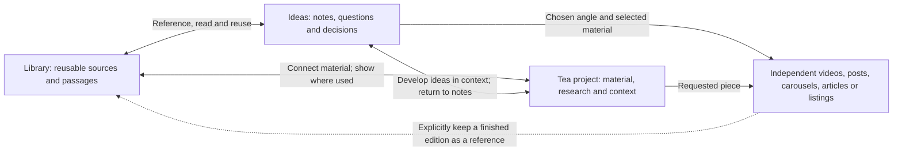

# Library, ideas and tea projects — next design pass

18 October 2026 · Proposed design sequence for Adrian's review.

**Boundary:** leave the active Claude Design pass, its attachments and its next returned version unchanged. This plan is for a subsequent pass. It does not start implementation, modify the installed application, replace an editor or source store, import private material, enable providers, or authorize publication. Accepted product intent lives in PRODUCT.md; this document proposes how to design it together. Requirements and proposed screens are not completion proof.

## One connected workspace

The recommended approach is **agree the connections first, develop three focused experiences, then review one integrated journey**. Do not design three independent applications and leave their relationships until the end.

| Area | What it is for | What it owns | What it connects to |
| --- | --- | --- | --- |
| Library | Find, read, organize and reuse the resources deliberately kept | Original-linked resources, related versions/translations, passage references, annotations, personal relevance and known reading coverage | Many projects, ideas, research inquiries and outputs |
| Idea development / concept brainstormer | Explore what the author wants to understand or say | Rough notes, questions, protected phrases, alternatives, selected references and explicit creative decisions | Library passages, existing projects, research and optional independently edited outputs |
| Tea project | Develop ongoing work around a tea and the author's encounter with it | Project context, selected resources, research, ideas and requested pieces | Shared Library resources, other relevant projects and Teajia's supplied product reference |

A tea project is a normal flexible project, not a separate product database or mandatory project type. Idea development is a working surface within the same project model, not another application or manuscript authority. An idea can stand alone without a tea or output; a tea project can contain several ideas; an idea can draw on several teas and conversations. Turning an idea into work does not require an irreversible Convert action or a fresh intake process.

Projects and Library need clearly distinct entrances. The compact current/pinned/recent project rail remains a return point; the full resource Library and All projects serve different jobs. Precise navigation labels remain a design choice. An internal source service named collections does not mean topic collections and projects must become the same user-facing object.

The arrows are links and deliberate handoffs, not automatic copying, approval, generation or synchronization. Adding notes or research to a project may deliberately create a new resource. Merely linking a source does not create another original. Keep a completed edition as a Library reference only through an explicit action; a new draft is not automatically indexed as authoritative evidence for itself.

## Personal expression and either starting point — one existing tool

This is an integrated part of AR Create. Library discovery, concept development, research and output creation must not become new islands. The author can enter through either route and continue in both directions:

- **Concept first:** start a thought or question; express personal feelings, memories, observations and what they hope to convey; then ask for relevant or challenging Library material and research when useful.
- **Material first:** find a conversation, passage, image or clip; begin or connect an idea; add the author's personal response, questions and direction.

Neither route is the default prerequisite. Both can stay exploratory with no deliverable. Saving a concept must not depend on retrieval, having a transcript or creating an article. The example and next design review must demonstrate both routes rather than imply Library → concept is the required order.

At the concept entry, provide a prominent continuous editable place for **the author's own contribution**. A proposed plain label is Your thoughts; it is not an approved final label or a compulsory extra form. The author can type, speak through existing supported/permitted tools, or attach a personal note/image/clip. They should be able to express what happened, how it felt, what it means to them and what they want to communicate. Library links and AI discussion assist this work without displacing it. Notes can grow and change throughout the project, rather than becoming a one-time setup answer.

Personal contributions have two compatible uses: original material for content and direction for how AI helps. Do not reduce them to prompts, untraceable chat context, outside evidence or automatically polished AI prose. Keep the author's exact original version alongside any proposed structure/interpretation. Respect explicit background-only or intended-for-use choices without adding a classification chore to every sentence. Carry relevant intent into tone, emphasis, selected visuals, narration and sequence as well as writing. Show what the author chose and which pieces it guides; keep later changes reversible and scoped.

### Integration points in the current application

| Existing part | Extension for this work | What remains shared and preserved |
| --- | --- | --- |
| Project creation and resume | Start from an idea or existing material and return to the same evolving work | Existing project/part identity, short rail, All projects and saved position; no mandatory new project type or conversion |
| Material | Add personal notes/media and find/link existing Library resources around the concept | Existing source identities, intake for new material, folder relationships and processing tools; no second source store |
| Research | Explore questions arising from the author's thinking or sources and return useful understanding to the same work | Existing Magazine/Atlas inquiry, evidence distinctions and human decisions; no compulsory output or duplicate research process |
| Direction | Hone what the author wants to express, compare angles and decide which requested pieces to make | Same concept context, original personal contributions, alternatives/rejections and existing scoped direction records; no new thirteenth stage |
| Existing editors, media work and Outputs | Use selected concept context to develop each requested expression | Existing manuscript authority, media tools/templates, independent content/revision/review, exact saved Undo and actual export contracts |

These are interaction/ownership connections, not an approved storage schema. Reuse maintained file/context/decision mechanisms; if a new persisted field becomes necessary, the integrator must identify the bounded gap before implementation rather than create a parallel engine or bulk migration. A global Library view and a concept surface remain places inside this tool, not separate products, required permanent chats or competing workflows.

The next design pass must reconcile these extensions with the design currently being built and the working code, preserving the chosen editor, navigation and live handlers. No current Claude attachments, brief or next result are changed. Do not build a standalone prototype application as the implementation of this concept workflow.

## Concepts are for content, not only writing

The author explicitly clarifies that ideas can become videos, social/visual posts, carousels and other content as well as articles. An idea may start with footage, an image, a voice thought or references rather than typed prose. A script is one possible supporting artifact; it is not the finished video and is not a compulsory entrance. Keep the shared concept independent of its eventual format. Use the current document tools for writing and notes, with appropriate media preview/selection/sequence surfaces when relevant rather than rendering every activity as a text page.

The later design should demonstrate a single concept supporting a short video and a post as well as optional long-form work. Show selected clips/images, intended sequence, narration/captions and format-specific framing where requested; connect to maintained media work instead of inventing a new engine. Each output keeps its own content, layout/sequence, revisions and human review. Represented video tools and proposed output routes do not mean video assembly, rendering, AI trimming or platform publication are connected. This clarification leaves the current Claude pass unchanged.

## Shared behavior to agree before separate design

1. **Reference the same resource.** Opening a transcript from a project or an idea returns to the same recording/transcript/version chain. Topic collections and project membership do not silently move physical originals. Show original location and availability under useful secondary details.
2. **Distinguish scopes.** A source annotation describes the resource; a project note describes this work; a direction can apply to one output. When broader scope is ambiguous, keep the contribution local and make scope visible. Do not promote one piece's decision into a universal belief.
3. **Keep the author's meaning.** Personal experience, exact words, corrections, chosen directions, rejections, direct edits and later changes of mind retain attribution, scope and revision. AI suggestions stay separate until accepted. Research can challenge an idea without silently deciding what the author believes.
4. **Pass selected context, not the entire library.** Search suggestions show the matching excerpt, its origin and why it fits, with full context reachable. Explicitly chosen notes/passages and relevant decisions carry into research, directions and drafting. No blanket private-library upload follows from search intent.
5. **Use material without repeated intake.** A deliberately kept resource can be linked directly. Unknown incoming recordings/files use existing intake review and processing; receiving audio is not successful transcription. A project may start with notes and acquire recordings later.
6. **Changes invite targeted review.** A corrected transcript, revised note or superseded direction identifies relevant downstream work and preserves the version used. Do not overwrite current words, silently approve claims, re-run AI or invalidate unrelated sibling outputs. If exact impact is unknown, state that review may be needed.
7. **Keep movement and removal unambiguous.** Remove from this project, remove from a topic collection, archive and delete an original have different consequences. Default organization is reversible. This design task authorizes no deletion operation or original-file moves.
8. **Preserve continuity.** Library detours, opening an idea and switching projects return to the right document/part/output and position. Save failures protect the current words. Keep exact saved Undo, historical snapshots, source identity and independent output approvals.

## Design sequence

### A. Map the basic connections

Produce one low-detail navigation/relationship map, a concise vocabulary and a single invented tea example. Show where Library, Projects, ideas, Research and Outputs are reached; how to return; and what gets linked rather than copied. Use the current Claude result when available and the then-current working application as the foundations. This is a map for the next pass, not another full visual redesign.

**Review criterion:** Adrian can explain where to keep a conversation, where to think about it and where to develop a tea release without learning three workflows. Display the proposed empty states as well as the populated example.

### B. Develop Library on its own

Design for substantial growth: a complete Library entrance, clear filing/home locations, topic collections, search, resource/language filters and useful saved views. Keep result loading bounded. Show readable list/preview modes and media thumbnails where useful; a file tree alone cannot carry the experience. Do not force every resource into one exclusive topic or require a metadata questionnaire.

Show own writing, participated conversations/transcripts, saved reading/PDFs/ebooks, translations and video references. Translations remain linked to their originals. Find the resource through a remembered topic as well as available names and metadata; demonstrate planned meaning-based discovery honestly if not connected.

On a resource, read/play what is actually supported, inspect original/corrected/translated versions, mark an exact passage, add why it matters, and see where it is used. Provide clear actions such as Use in a project and Add to an idea. Existing project material should be reusable without another import.

Keep personal connection, factual credibility and reading coverage separate. Saving a book does not mean reading it; AI processing is not human endorsement. A personally marked book passage can be more relevant than a loosely related personal conversation. No opaque universal importance score or compulsory format ranking.

**Design checks:** synthetic mixed catalog large enough to prove bounded navigation (for example 1,000 resources), no matches, unavailable desktop original, unsupported reader, partial reading, original/translation pairs and one source used in multiple projects. No actual thousand-resource import or indexing work is authorized by this design example.

### C. Develop idea work on its own

Start with a thought, belief, question, photo/clip, spoken reflection or rough notes. Recommend a continuous mixed-material scratch surface with editable notes, movable sections, accessible media references and optional contextual AI discussion. The author can start with any of those, explore several angles and leave without producing content. Avoid mandatory title, recording, output or belief forms.

Demonstrate: write a personal point; recall two conversations and a related article; inspect suggested matching passages; select references; ask a question; examine contrary evidence; refine a phrase; compare possible titles/angles; record a rejection and its reason. Source wording, human notes and AI interpretation remain visibly distinct.

Keep a small understandable set of current creative decisions near the work; retain history behind it rather than making the document a wall of warnings. Choosing an angle for a short post must not narrow every other possible piece or rewrite the original scratch notes.

**Design checks:** no sources yet; several candidate conversations; ambiguous speaker; an unavailable reference; a changed source; pending/unconnected AI; a later change of mind. Return after a Library detour without losing place or words.

### D. Develop the tea-project experience on its own

Use the existing project and stage-specific surfaces. Show actual roles for recordings/transcripts, opening/closing notes, personal tasting/discovery, photographs/video, clearly labeled generated artwork, research questions and supplied product information. Keep Library additions and new material intake available in place.

Provide a concise project overview with a meaningful next action, accessible research/idea work and requested output links. Preserve the twelve underlying checkpoints; this plan does not add three new compulsory stages. A collection can remain learning/material only, or produce a post/listing before an article exists.

Show supported product facts, attributed seller claims, unresolved claims and the author's sensory experience distinctly. A Teajia product reference connects listing content to the existing shop record; AR Create does not own price, stock or orders. Each selected article, post, listing, carousel or script has its own words, selected material, review, version and actual delivery status. Do not populate unrequested formats as unfinished obligations.

**Design checks:** new tea with only photos and a rough note; a tea with several recording sessions; a project with no planned outputs; several pieces in different states; generated versus actual product imagery; adding new research after one piece has been completed.

### E. Integrate the complete experience

Combine the reviewed components with the returned Claude design in one isolated design candidate. Align navigation, hierarchy, typography, compact controls, status vocabulary and return behavior. Do not squeeze every surface into a single layout; each must serve its work. Present unfinished operations in their proper places with explicit illustrative/not-connected behavior; a prototype must not masquerade as a working save or AI result.

Use one coherent illustrative journey:

1. Show both entrances: begin with the author's concept and personal thoughts before any Library lookup; alternatively find a conversation and read the exact relevant turn.
2. Continue in the same concept/project; link a relevant conversation and marked book passage, preserving the author's personal expression as its own material.
3. Connect that idea to an existing tea project and add another recording or photo there.
4. Develop understanding through Research; carry the author's chosen point and protected phrase forward.
5. Develop a short video direction and social post from one concept; show chosen clips/images, framing, sequence/narration and independent review as appropriate. An article or listing is optional and not a prerequisite. Clearly label any video production/rendering operation that remains unconnected.
6. Edit one piece, visit another project, return to the right place and inspect where its sources came from.
7. Correct a shared source; show affected work needing review without changing accepted words.
8. Show actual export/publication status only where supported and known; no automatic shop/social release.

**Review criterion:** the author can move through this journey without repeated import, repeated explanations, scattered note boxes, lost context or extra ceremonial clicks. Check wide/narrow and Light/Dark, useful scrolling, multi-item selection where appropriate, keyboard return and the empty/processing/error/read-only/changed states that affect this journey. Human visual review is separate from functional proof.

### F. Wire reviewed slices through the existing owners

Only after the relevant design direction is reviewed, Delivery turns its gaps into bounded rows on the existing board. Build retains sole shared wiring and local activation. Reuse the source/collection services, transcript versions, passage references, current project model, research/brief process, editor, templates and independent output authorities. Do not select a new search engine/database, provider account, synchronization system or editor through a visual mockup.

Implementation proceeds in useful connected slices rather than waiting for every Library feature: select an existing resource into idea notes; preserve selected notes/decisions into a project/output; then deepen browsing and format coverage. Design and unfinished connection work may proceed concurrently under the established protected integration rules, but this planning request starts neither. Run focused affected checks and a synthetic screen/file journey before any verified claim; preserve real sources and drafts. Source delivery, private hosting and live cutover remain separate permissions and evidence.

## Focused choices to show in the later pass

| Choice | Recommended first direction | Alternative and trade-off |
| --- | --- | --- |
| Library browsing | Topic-aware list with a strong readable preview and type/language filters | Format-first shelves feel familiar but can separate related writing, conversations and books; explore only if the list is hard to orient in |
| Idea work | Continuous mixed-material notes, image/clip references and compact margin discussion | A spatial board supports visual grouping but adds navigation/arrangement effort; it must not become a new editor-engine project |
| Tea-project overview | Concise context sheet, current work and independent output links | A media-forward overview helps highly visual projects but can bury research and author decisions; compare using the same example |

These are proposals, not approved layouts. Show focused alternatives for consequential unresolved choices, preserve what Adrian already likes, and avoid restarting design exercises across every existing stage.

## Requirements, ownership and finish line

Requirements: C01 human creative control; C02 project pickup at scale; C03 shared sources/independent outputs; C04 files/recovery; C05 clarity; C06 honest evidence/AI; C07 privacy. Primary briefs S01–S04; existing S05–S12 remain the output/edit/media/review/delivery contracts.

Root maintains this connected direction and accepted brief changes. Delivery maintains one queue and the interface-present/connected/verified/human-accepted distinctions. The current Claude designer completes the frozen active pass. A later design pass develops the focused areas and combined experience; no separate permanent chats or parallel code ownership are created here.

The finish for this plan is a reviewed connected design and a clear wiring map against the working application, not a claim that a Library, brainstormer and all delivery formats have been built. Existing unfinished AI, extraction, media, platform export and private synchronization capabilities stay explicitly unfinished until separately proven.
